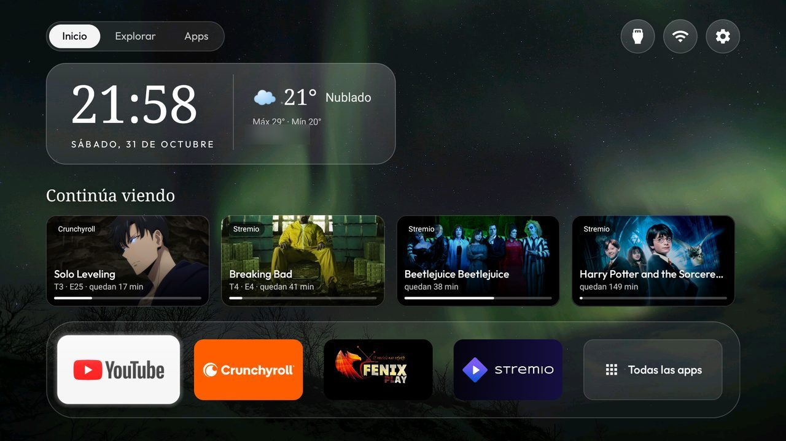

# CleanYourTV Editorial (a fork tested on a Durabrand TV)

A fork of [Gathin23/cleanyourtv](https://github.com/Gathin23/cleanyourtv)'s launcher with an editorial Home: the
clock and the weather on a glass panel, the wallpaper's name set large like a magazine cover, a Continue watching
row, Home / Explore / Apps tabs and a dock that ends in an All apps tile. Everything else is the upstream launcher,
unchanged, and every addition below is **off by default**: a theme turns it on.



Built and tested on a **Durabrand DB Android TV 4K** (`DURAT32ISDB`, Haier/CVTE `dupont` board, Android TV 11,
firmware `RTM6.230109.232`), with the real remote, D-pad from every edge.

## What it adds

| Key | What it does | Needs |
|---|---|---|
| `editorial_home` | The clock and a one-line date on a translucent glass panel in a serif face; the wallpaper caption large under it, its credit (after ` · ` in `captions.txt`) on a small line. The caption steps aside while focus is below the dock. | Nothing new |
| `weather` | The temperature, the sky in words and today's high and low beside the clock, from [Open-Meteo](https://open-meteo.com/) (no account, no key). Fetched only while Home is on screen, every 30 minutes; nothing runs in the background. | `INTERNET`, and `latitude` / `longitude` in `config.xml` |
| `weather_place` | The place's name under the reading. `config.xml` only. | `weather` |
| `dock_library_tile` | Home is the dock alone, ended by an All apps tile inside the dock's band that opens the App library. | `app_library` |
| `continue_watching` | Up to four cards above the dock from what apps publish to the TV provider (Watch Next, and a preview channel named like "Continue watching", as Stremio keeps): the last 60 days, unfinished. OK opens the row's own link. | `READ_TV_LISTINGS`, granted with `pm grant`; pictures come over the network |
| `home_tabs` / `explore_uri` | Home / Explore / Apps tabs above the panel. Explore opens a link an installed app handles, for example `stremio:///discover`; Apps opens the App library. | `editorial_home` |

Strings are in English, Spanish and Hebrew. Each key has its row in [`themes/README.md`](themes/README.md) and a
screenshot in [`docs/switches.md`](docs/switches.md).

## Why a fork

Upstream keeps the launcher small and offline on purpose: no `INTERNET`, no new permissions, and look-only
switches live in forks (see [`AGENTS.md`](AGENTS.md), "Where a change goes"). `weather` and `continue_watching`
need both, so this build adds `android.permission.INTERNET` and `android.permission.READ_TV_LISTINGS` to the
manifest. With the keys off, nothing new runs, but the permissions are still declared: build upstream if you do
not want them.

What goes over the network, only with the keys on: the latitude and longitude you set, to `api.open-meteo.com`;
and the Continue watching pictures, from the addresses the apps published. No analytics, no telemetry.

## Build and install

The same as upstream ([`docs/launcher.md`](docs/launcher.md)): JDK 17, Android SDK 34, then in `launcher/`

```sh
./gradlew --no-daemon testReleaseUnitTest lintRelease assembleRelease
```

and `launcher/build-and-install.sh` (or `.ps1`) to install it as Home. Before building, set your place in
`launcher/app/src/main/res/values/config.xml` if you want the weather:

```xml
<string name="latitude" translatable="false">54.69</string>
<string name="longitude" translatable="false">25.28</string>
<string name="weather_place" translatable="false">Vilnius</string>
```

For Continue watching, grant the permission once:

```sh
adb shell pm grant com.gathin.tvhome android.permission.READ_TV_LISTINGS
```

## Turn it on

A theme's `config.json`, pushed with `tools/theme.sh` (or `tools\theme.ps1`), for example over the `sweden` theme's
pictures:

```json
{
  "editorial_home": true,
  "date_below_clock": true,
  "show_greeting": false,
  "header_white": true,
  "wallpaper_captions": true,
  "wallpaper_dim": 35,
  "weather": true,
  "app_library": true,
  "dock_library_tile": true,
  "continue_watching": true,
  "home_tabs": true,
  "explore_uri": "stremio:///discover"
}
```

## Notes from the Durabrand

- What apps publish to Continue watching varies. On this TV, Crunchyroll's Watch Next rows (dated, often years
  old: hence the 60-day window) and Stremio's undated "Continue Watching" channel showed up; YouTube and the IPTV
  app published nothing. [`docs/watch-next.md`](docs/watch-next.md) covers the provider's rules.
- The APK is about 13 KB over upstream's size gate with every addition built in; that gate is upstream's, for the
  1 GB TVs it targets.

## Credits

The launcher, the tools and the `sweden` theme's pictures are upstream's, by
[Gathin23](https://github.com/Gathin23) and its contributors. The additions here are by
[kevscec](https://github.com/kevscec). MIT, as upstream ([`LICENSE`](LICENSE)).
